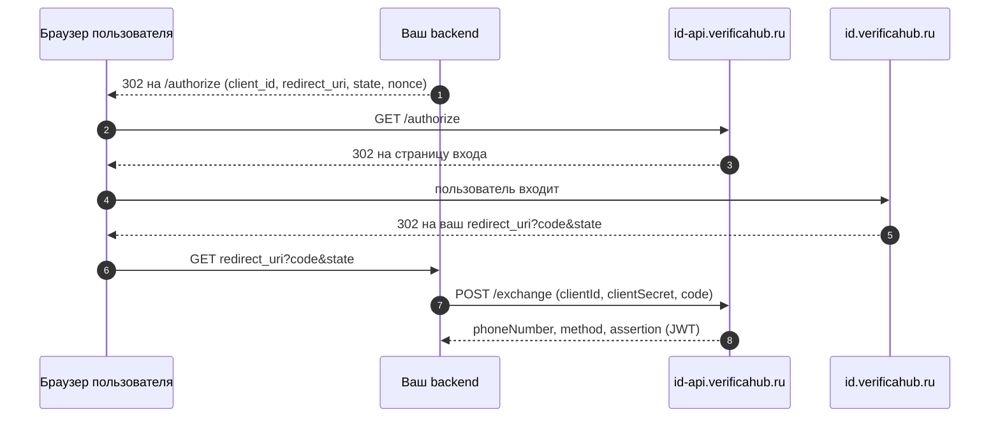

# Verificahub ID

Verificahub ID — готовая страница входа по номеру телефона. Вы отправляете пользователя на
`id.verificahub.ru`, он входит удобным способом и возвращается к вам, а ваш сервер получает его
подтверждённый номер и подписанное подтверждение (JWT).

Поток устроен как OAuth 2.0 authorization code: браузер только проходит через страницу входа, а
номер ваш сервер забирает напрямую у нас — по одноразовому коду и секрету клиента.

## Verificahub ID или API

| | Verificahub ID | [Verificahub API](../integration/overview.md) |
|---|---|---|
| Интерфейс | готовая страница входа под ваш бренд | строите сами |
| Что делает ваш сервер | перенаправляет пользователя и меняет код на номер | создаёт сессию, принимает вебхуки, проверяет коды |
| Результат | номер + JWT, подписанный Verificahub | статус сессии |
| Подходит, когда | нужен вход по номеру быстро и без своего UI | нужен полный контроль над интерфейсом |

## Как это работает

Пошагово — в разделе [Подключение](./integration.md), про всплывающее окно и мобильные приложения —
в разделе [Где открывать страницу](./embedding.md).

## Способы входа

Набор способов задаётся в настройках клиента. Сейчас для Verificahub ID доступны:

| Способ | `method` | Уровень `acr` |
|---|---|---|
| SIM-push (МТС «Мобильный ID») — запрос на SIM-карту, без ввода кода | `mts_id` | `high` |
| SMS с кодом | `sms` | `medium` |
| Код в Telegram | `telegram_otp` | `medium` |

Сейчас используется первый способ из списка клиента. Выбор способа самим пользователем, вход через
аккаунты (Яндекс ID, VK ID, Сбер ID, T-ID, МТС ID) и код в MAX — в разработке.

## Что получает ваш сервер

- **Номер телефона** в формате E.164 (`+79991234567`).
- **Способ входа** (`method`) и **уровень доверия** (`acr`).
- **Подтверждение** — JWT, подписанный ключом Verificahub ID. Именно ему стоит доверять, а не
  остальным полям ответа: подпись проверяется по открытым ключам
  `https://id-api.verificahub.ru/.well-known/jwks.json`.

Пароли, коды и данные карт пользователя Verificahub ID не запрашивает и не передаёт.
