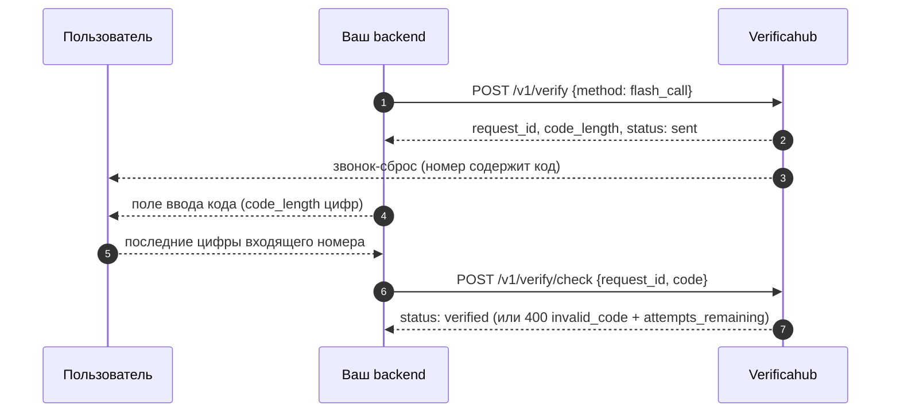

# `flash_call` — код из номера входящего звонка

Мы делаем звонок-сброс на номер пользователя, и **код — это последние `code_length` цифр входящего
номера**. Пользователь считывает их с экрана и вводит у вас.

## Что учесть

- **Объясните пользователю, что вводить.** «Последние 4 цифры номера, с которого поступил звонок» —
  без этой подсказки конверсия заметно ниже, чем у SMS.
- **Отвечать на звонок не нужно**, он сбрасывается сам.
- **Не путайте с [`reverse_flash_call`](./reverse_flash_call.md)**: там звонит пользователь и код не
  вводится вовсе.
