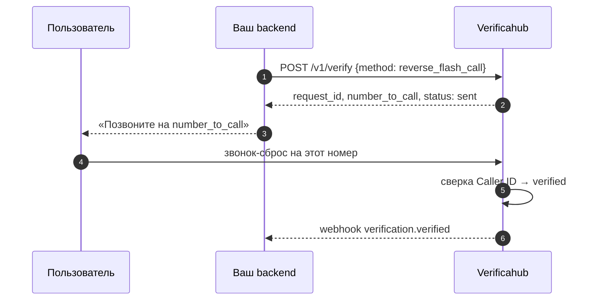
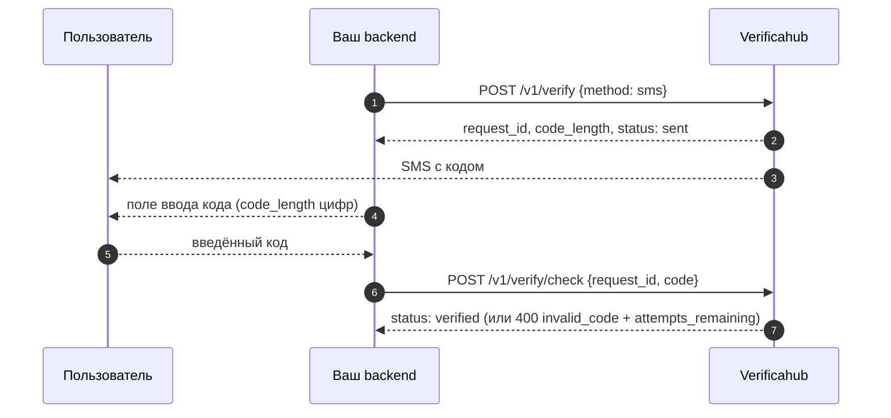
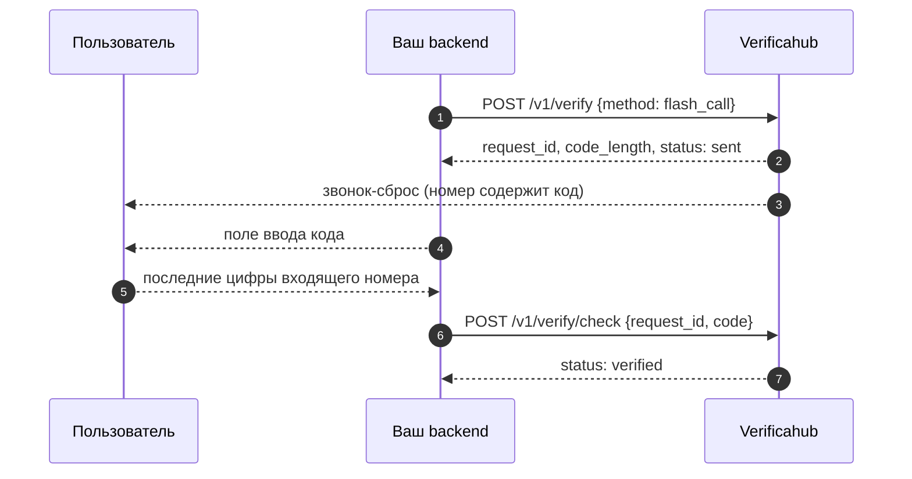
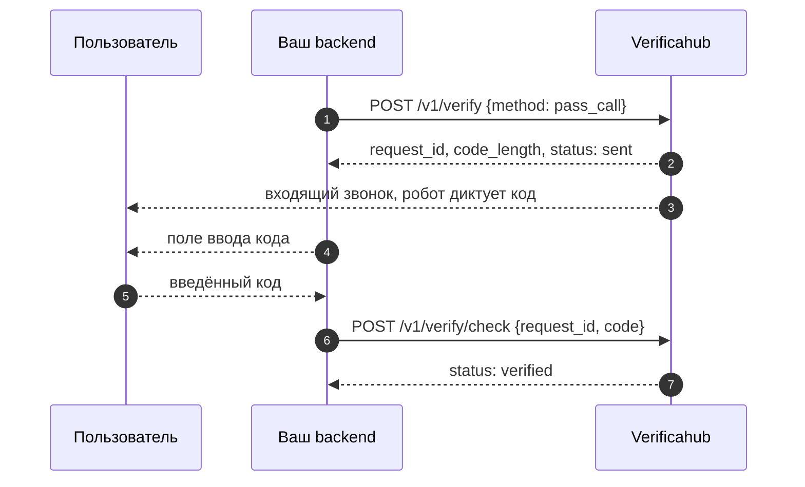
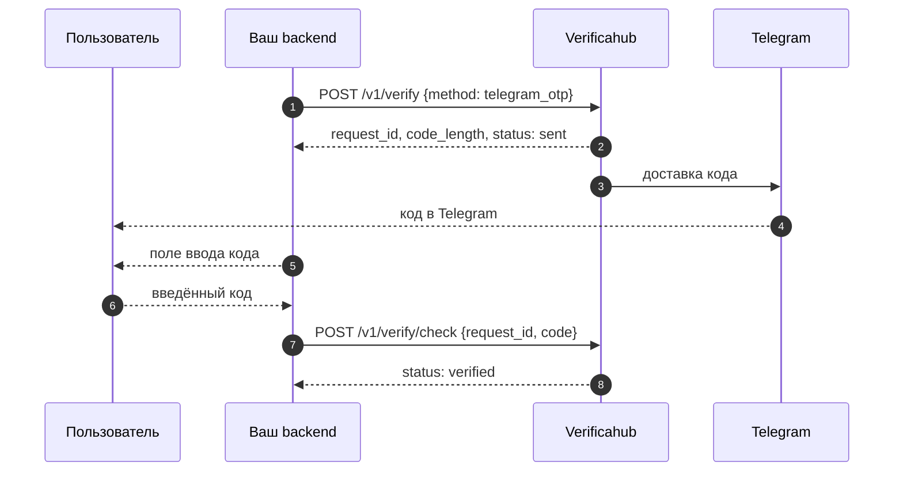
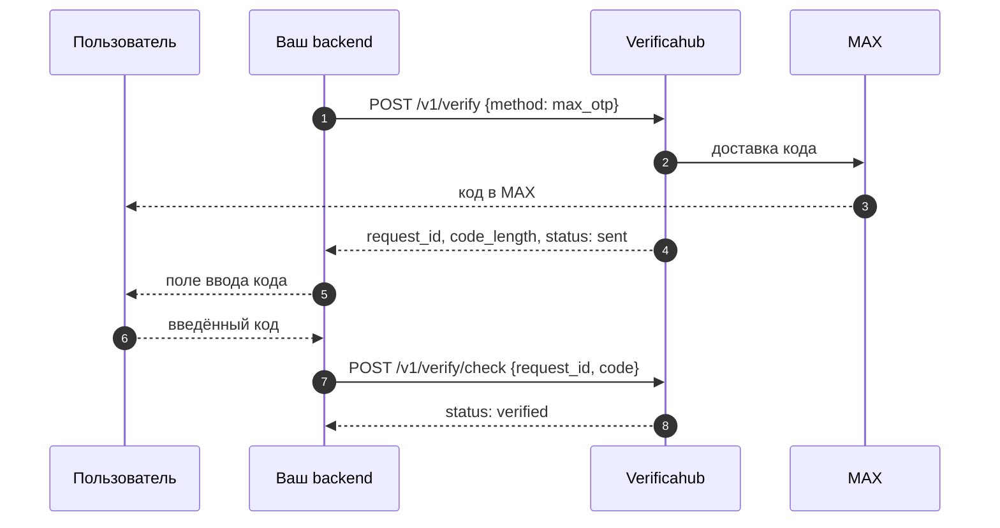
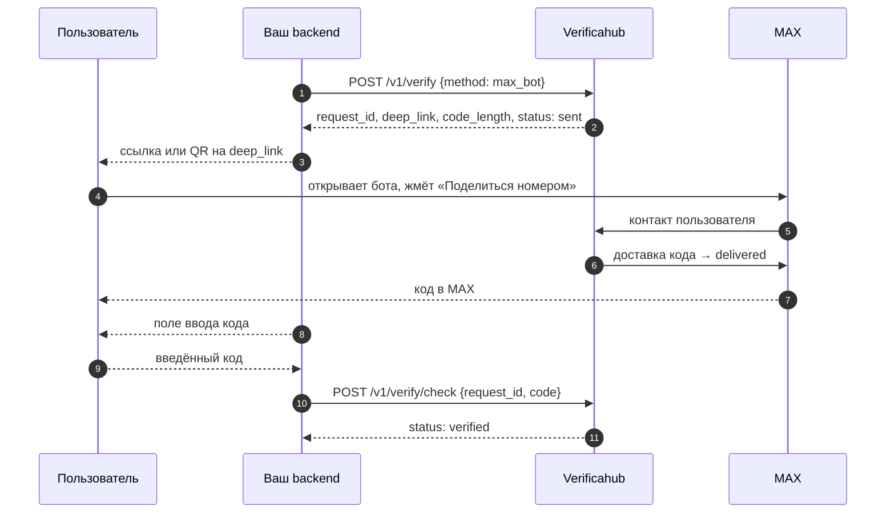
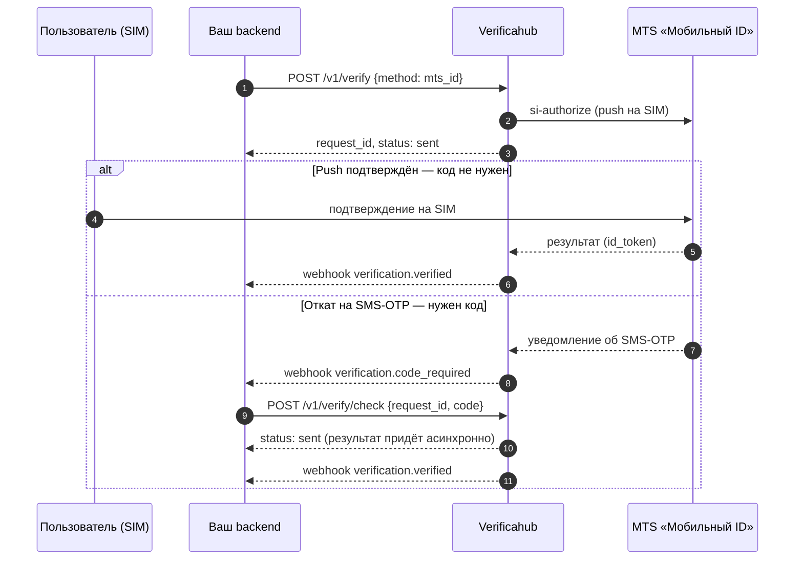

# Как работают потоки подтверждения

Общая схема одна для всех методов: `POST /v1/verify` создаёт сессию, а результат вы узнаёте либо по
[вебхуку](../webhooks.md), либо опрашивая `GET /v1/verify/{request_id}`. Отличается только середина —
то, как пользователь проходит подтверждение.

Статусы сессии: `sent` → `delivered` (необязательный) → `verified`, либо `expired` (истёк TTL) /
`failed` (терминальная ошибка).

## Какой метод выбрать

Главный вопрос — нужно ли вам поле ввода кода.

| Без ввода кода | С вводом кода |
| --- | --- |
| [`reverse_flash_call`](./reverse_flash_call.md) — пользователь звонит сам | [`sms`](./sms.md) · [`flash_call`](./flash_call.md) · [`pass_call`](./pass_call.md) |
| [`mts_id`](./mts_id.md) — подтверждение на SIM, но с откатом на код | [`telegram_otp`](./telegram_otp.md) · [`max_otp`](./max_otp.md) · [`max_bot`](./max_bot.md) |

Какие методы доступны вашему аккаунту и сколько стоят — см.
[Методы подтверждения и тарифы](../../guides/methods.md).

## [`reverse_flash_call`](./reverse_flash_call.md) — без ввода кода

Пользователь сам звонит на выданный номер, мы подтверждаем по Caller ID. Код никто не вводит.

→ [Подробнее про `reverse_flash_call`](./reverse_flash_call.md)

## [`sms`](./sms.md) — код в SMS

Код приходит пользователю по SMS; он вводит его у вас, вы отправляете на проверку. Та же схема
«код → `/v1/verify/check` → `verified`» работает и у остальных методов с вводом кода.

→ [Подробнее про `sms`](./sms.md)

## [`flash_call`](./flash_call.md) — код из номера входящего звонка

Мы делаем звонок-сброс, и код — последние `code_length` цифр входящего номера. Пользователь
считывает их с экрана.

→ [Подробнее про `flash_call`](./flash_call.md)

## [`pass_call`](./pass_call.md) — робот диктует код голосом

Робот звонит и проговаривает код. В отличие от `flash_call`, на звонок нужно ответить.

→ [Подробнее про `pass_call`](./pass_call.md)

## [`telegram_otp`](./telegram_otp.md) — код из Telegram

Код доставляет официальный бот Telegram.

→ [Подробнее про `telegram_otp`](./telegram_otp.md)

## [`max_otp`](./max_otp.md) — код в мессенджере MAX

Сообщение приходит само, без ссылок и действий со стороны пользователя.

→ [Подробнее про `max_otp`](./max_otp.md)

## [`max_bot`](./max_bot.md) — код через бота в MAX

Пользователь открывает бота по `deep_link` и жмёт «Поделиться номером» — код приходит только после
этого. Списание — по факту доставки.

→ [Подробнее про `max_bot`](./max_bot.md)

## [`mts_id`](./mts_id.md) — подтверждение через оператора

Два пути, и заранее не известно, какой сработает: обычно оператор подтверждает прямо на SIM, но при
неудаче происходит откат на SMS-OTP. **Не показывайте поле ввода кода сразу** — ждите вебхук
`verification.code_required` или флаг `awaiting_code: true`.

→ [Подробнее про `mts_id`](./mts_id.md)

## Узнать результат: вебхук или опрос

Оба способа рабочие, и их можно комбинировать (вебхук как основной, опрос — как страховка):

- **Вебхук** — мы сами присылаем событие на ваш URL (см. [Вебхуки](../webhooks.md)).
- **Опрос** — периодически запрашивайте `GET /v1/verify/{request_id}` до терминального статуса.

Источник истины при расхождениях — `GET /v1/verify/{request_id}`.
