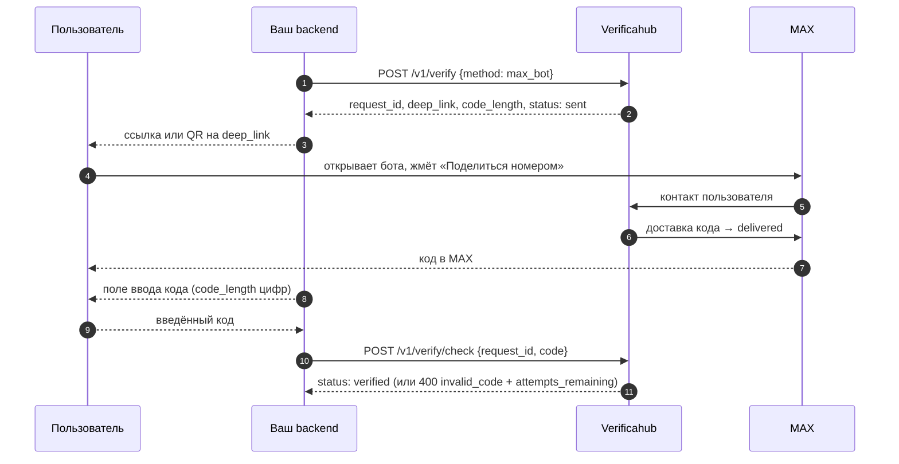

# `max_bot` — код через бота в MAX

Отличие от [`max_otp`](./max_otp.md) — пользователь должен сам начать диалог. В ответ на
`POST /v1/verify` приходит поле `deep_link` (`https://max.ru/<bot>?start=<token>`); покажите его
ссылкой или QR-кодом. Пользователь открывает бота, жмёт **«Поделиться номером»** — и только после
этого код приходит в MAX.

## Что учесть

- **Номер должен совпадать.** Пользователь обязан поделиться **тем же** номером, для которого
  запущена проверка, иначе код не отправляется.
- **Статусы различают шаги.** До «Поделиться номером» — `sent`; после доставки — `delivered` и
  `awaiting_code: true`.
- **Списание — по факту доставки.** Если пользователь не открыл бота или не поделился номером,
  оплата не взимается.
- **Лишний шаг стоит конверсии.** Если вам не нужен именно диалог с ботом, берите
  [`max_otp`](./max_otp.md).
