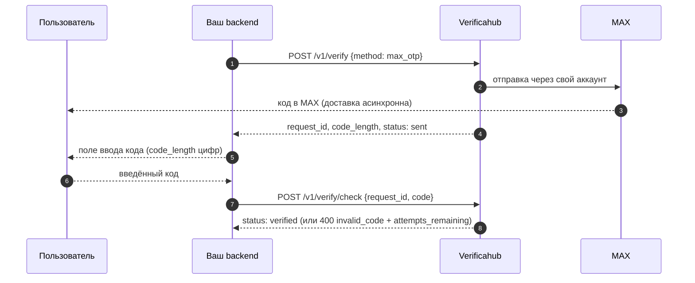

# `max_otp` — код в мессенджере MAX

Код отправляется сообщением в MAX без ссылки на бота и передачи контакта.
Перед первым использованием подключите [свои аккаунты MAX](../../guides/max_accounts.md)
в кабинете. Успешный ответ на `POST /v1/verify` подтверждает принятую отправку,
а не получение или прочтение сообщения пользователем.

## Что учесть

- **Не путайте с [`max_bot`](./max_bot.md).** Там пользователь должен сам открыть бота и поделиться
  номером; здесь — ничего не должен, сообщение просто приходит. Большинству сценариев нужен именно
  `max_otp`.
- **Показывайте поле ввода сразу** после ответа на `POST /v1/verify`: код уже отправлен.
- **У пользователя должен быть MAX на этом номере** — иначе доставлять некуда.

## Приватные отправители и ошибки

После подключения используются только ваши аккаунты. Если доступных отправителей
нет, отправка недоступна; общий пул не используется как резерв. Отсутствие MAX
у получателя возвращает `422 delivery_unavailable` без списания. При неизвестном
результате отправки не повторяйте запрос автоматически как новую проверку.
