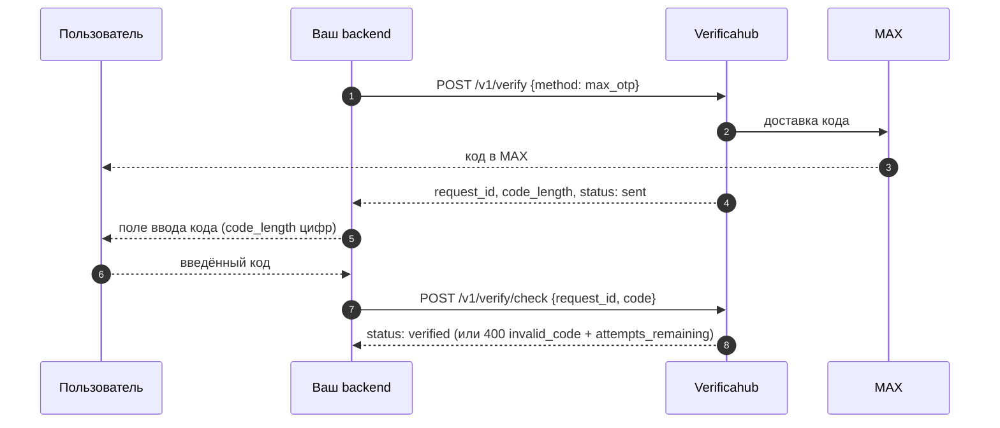

# `max_otp` — код в мессенджере MAX

Код приходит пользователю сообщением в MAX. Никаких ссылок и дополнительных действий: сообщение уже
доставлено к моменту, когда вы получаете ответ на `POST /v1/verify`.

## Что учесть

- **Не путайте с [`max_bot`](./max_bot.md).** Там пользователь должен сам открыть бота и поделиться
  номером; здесь — ничего не должен, сообщение просто приходит. Большинству сценариев нужен именно
  `max_otp`.
- **Показывайте поле ввода сразу** после ответа на `POST /v1/verify`: код уже отправлен.
- **У пользователя должен быть MAX на этом номере** — иначе доставлять некуда.
