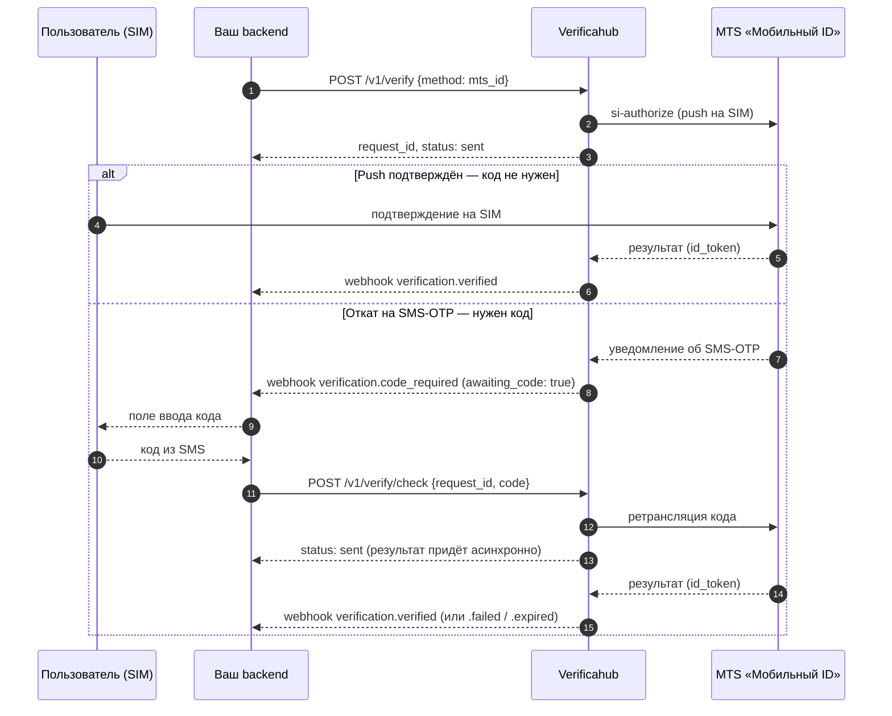

# `mts_id` — подтверждение через оператора (двойной путь)

Ключевая особенность: у `mts_id` **два пути**, и заранее не известно, какой сработает. Обычно оператор
присылает подтверждение прямо на SIM — и код не нужен. Но если push не проходит (например, номер
MVNO), происходит **откат на SMS-OTP**, и вот тогда пользователю приходит код, который нужно ввести.

Поэтому **не показывайте поле ввода кода сразу**. Ждите сигнала: вебхук `verification.code_required`
или флаг `awaiting_code: true` в статусе. Нет сигнала — кода не будет.

## Что учесть

- **Опрашивайте `awaiting_code`** (или слушайте `verification.code_required`) — только по этому
  сигналу показывайте ввод кода. До него `awaiting_code: false`.
- **`/v1/verify/check` асинхронный.** Мы ретранслируем код оператору, а окончательный результат
  приходит чуть позже. Поэтому ответ на `check` — `status: sent`, а не `verified`. Итог узнавайте по
  `GET /v1/verify/{request_id}` или вебхукам `verification.verified` / `verification.failed` /
  `verification.expired` (истечение таймаута подтверждения оператором приходит как `expired`).
- **Слишком ранний код** (до отката) вернёт `409 not_pending`.
