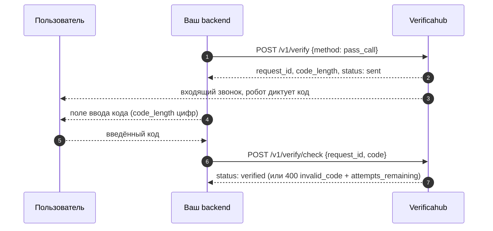

# `pass_call` — робот диктует код голосом

Робот звонит на номер пользователя и проговаривает код; пользователь вводит его у вас.

## Что учесть

- **На звонок нужно ответить** — в отличие от [`flash_call`](./flash_call.md), где звонок
  сбрасывается. Предупредите пользователя об этом в интерфейсе.
- **Списание происходит при инициации**, а не по факту разговора: звонок размещается в момент
  запроса независимо от того, возьмёт ли пользователь трубку.
- **Подходит как запасной канал** там, где SMS не доходят, а мессенджеров у пользователя нет.
