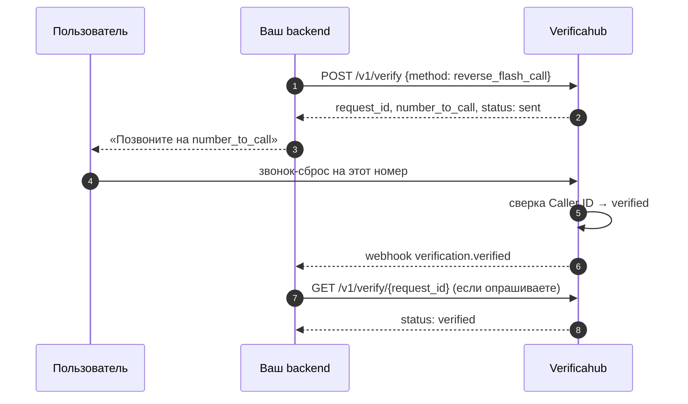

# `reverse_flash_call` — без ввода кода

Пользователь сам звонит на выданный номер, мы подтверждаем по Caller ID. Код никто не вводит.

Покажите пользователю `number_to_call`, а сами ждите `verified` (по вебхуку или опросом).

## Что учесть

- **`/v1/verify/check` для этого метода не используется.** Вводить нечего.
- **Номер выдаётся на сессию.** Берите его из ответа каждый раз, не кэшируйте: в следующей сессии он
  может быть другим.
- **Скрытый Caller ID не подтвердится.** Если пользователь звонит с антиопределителем, сопоставлять
  нечего, и сессия дойдёт до `expired`.
