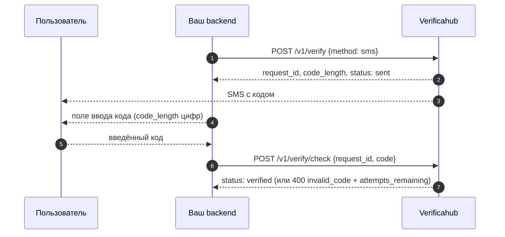

# `sms` — код в SMS

Мы генерируем код и отправляем его пользователю по SMS; пользователь вводит код у вас, вы отправляете
его на проверку.

## Что учесть

- **Длина кода — в `code_length`.** Не зашивайте её в вёрстку: она задаётся настройкой платформы.
- **При неверном коде** ответ `400 invalid_code` содержит `attempts_remaining`; после исчерпания
  попыток сессия переходит в `failed`.
