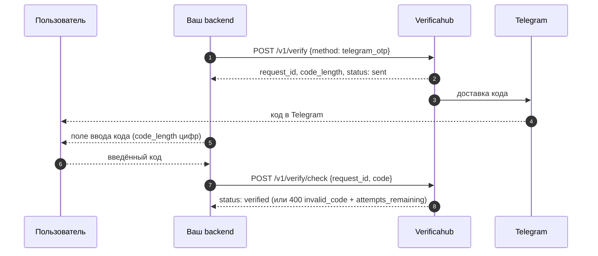

# `telegram_otp` — код из Telegram

Мы генерируем код и доставляем его в Telegram официальным ботом; пользователь вводит код у вас, вы
отправляете его на проверку.

## Что учесть

- **У пользователя должен быть Telegram на этом номере.** Если аккаунта нет, доставить код некуда —
  предусмотрите запасной метод.
- **При неверном коде** ответ `400 invalid_code` содержит `attempts_remaining`; после исчерпания
  попыток сессия переходит в `failed`.
