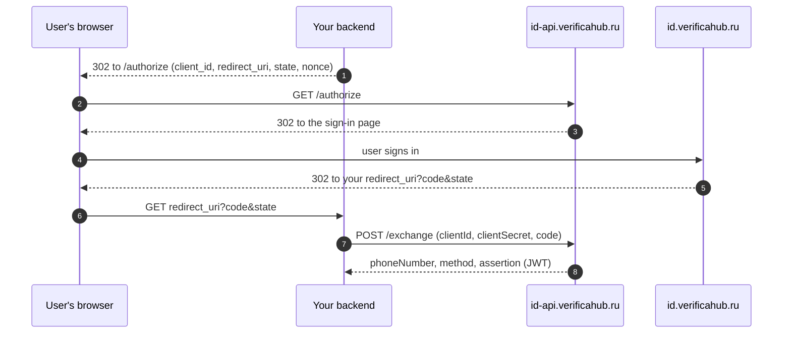

# Verificahub ID

Verificahub ID is a ready-made phone number sign-in page. You send the user to
`id.verificahub.ru`, they sign in with a convenient method and come back to you, and your server
receives their verified number and a signed assertion (JWT).

The flow works like an OAuth 2.0 authorization code flow: the browser only passes through the sign-in
page, and your server collects the number directly from us, using a one-time code and the client secret.

## Verificahub ID or the API

| | Verificahub ID | [Verificahub API](../integration/overview.md) |
|---|---|---|
| Interface | a ready-made sign-in page with your branding | you build it yourself |
| What your server does | redirects the user and exchanges the code for the number | creates a session, receives webhooks, checks codes |
| Result | number + JWT signed by Verificahub | session status |
| Use it when | you need phone sign-in quickly and without your own UI | you need full control over the interface |

## How it works

Step by step: see [Integration](./integration.md). Popups and mobile apps are covered in
[Where to open the page](./embedding.md).

## Sign-in methods

The set and order of methods are configured in the client settings. Either the user picks a method
(`choice`), or the page asks for the number straight away and Verificahub picks the method from the list
(`ladder`).

**By phone number** — Verificahub verifies the number:

| Method | `method` | `acr` level |
|---|---|---|
| SIM push (MTS Mobile ID) — a request to the SIM card, no code to enter | `mts_id` | `high` |
| Phone call — the code is the last digits of the number we call from | `flash_call` | `medium` |
| SMS with a code | `sms` | `medium` |
| Code in Telegram | `telegram_otp` | `medium` |
| Code in MAX | `max_otp` | `medium` |
| MAX bot — the user opens the bot and shares their number, the bot sends a code | `max_bot` | `medium` |
| “Call us” — the user calls our number, matched by caller ID | `reverse_flash_call` | `low` |

**With an account** — the number comes from a provider the user already confirmed it with:

| Provider | `method` | `acr` level |
|---|---|---|
| Yandex ID | `yandex` | `low` |
| VK ID | `vk` | `low` |

Two methods are `low`, for different reasons. With “call us” nothing secret travels: we match the caller
ID of an incoming call, and one can be forged. With account sign-in the provider vouches for a number
confirmed at some point, not for the SIM card in the user's hand right now. If possession of the number at
sign-in matters to you, check `acr` and ask for a code when it is `low`. Sber ID, T-ID and MTS ID are in
development.

## What your server receives

- **Phone number** in E.164 format (`+79991234567`).
- **Sign-in method** (`method`) and **assurance level** (`acr`).
- **Assertion** — a JWT signed with the Verificahub ID key. Trust this, not the other fields of the
  response: verify the signature against the public keys at
  `https://id-api.verificahub.ru/.well-known/jwks.json`.

Verificahub ID never asks for or passes on the user's passwords, codes or card details.
