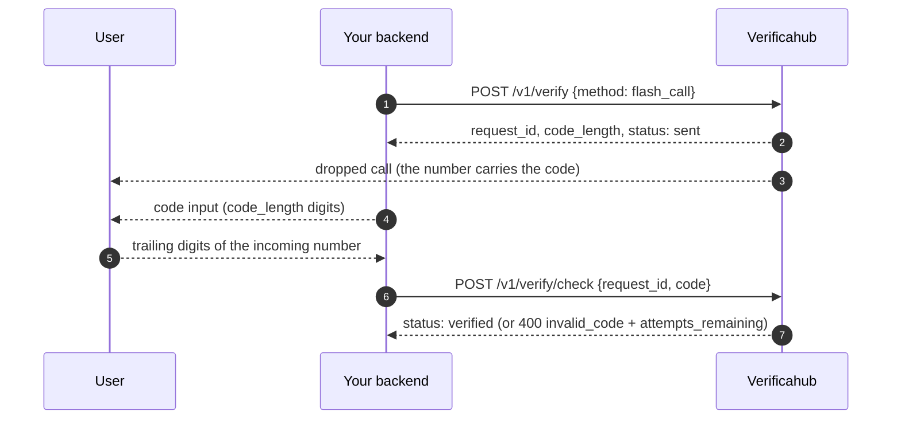

# `flash_call` — the code is in the incoming number

We place a dropped call to the user's number, and **the code is the trailing `code_length` digits of
the incoming number**. The user reads them off the screen and enters them on your side.

## What to watch for

- **Tell the user what to enter.** "The last 4 digits of the number that called you" — without that
  hint conversion is noticeably below SMS.
- **The call does not need answering**; it drops by itself.
- **Not to be confused with [`reverse_flash_call`](./reverse_flash_call.md)**, where the user places
  the call and no code is typed at all.
