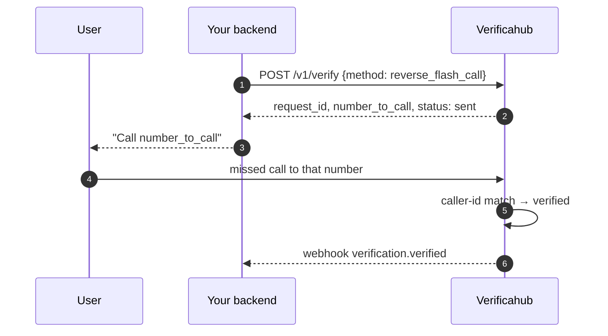
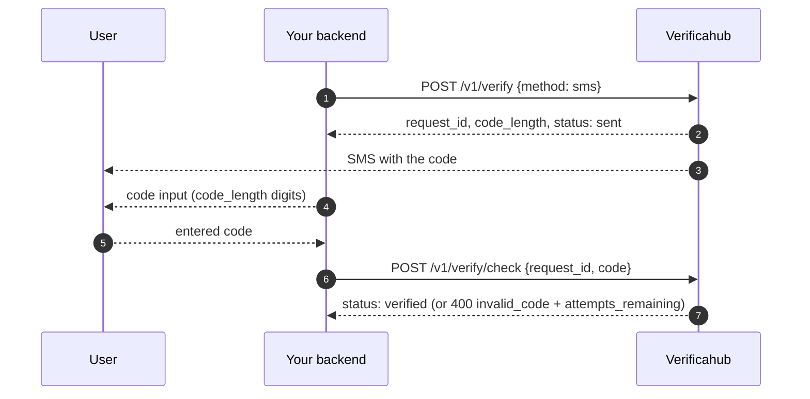
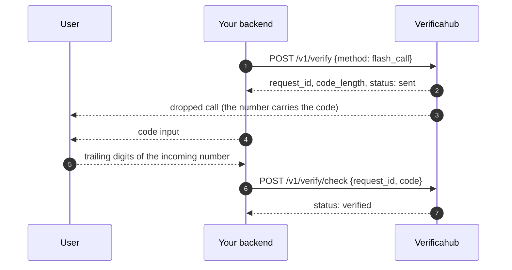
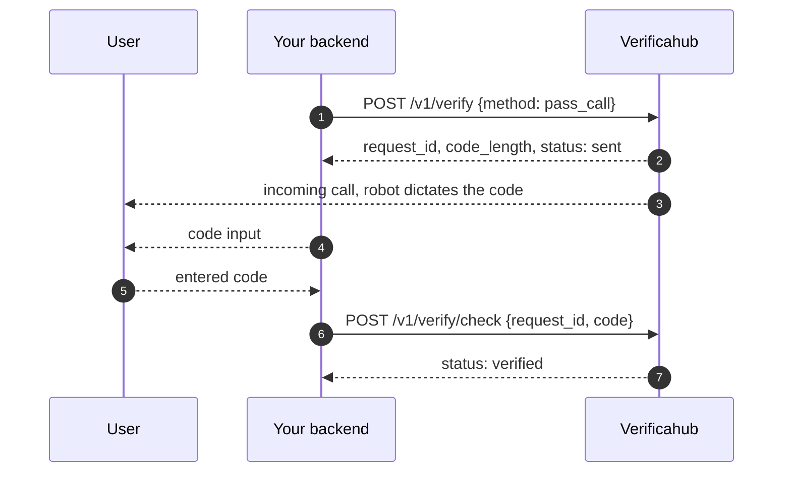
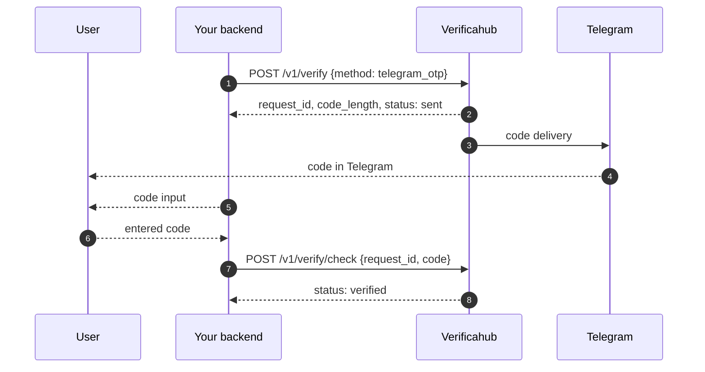
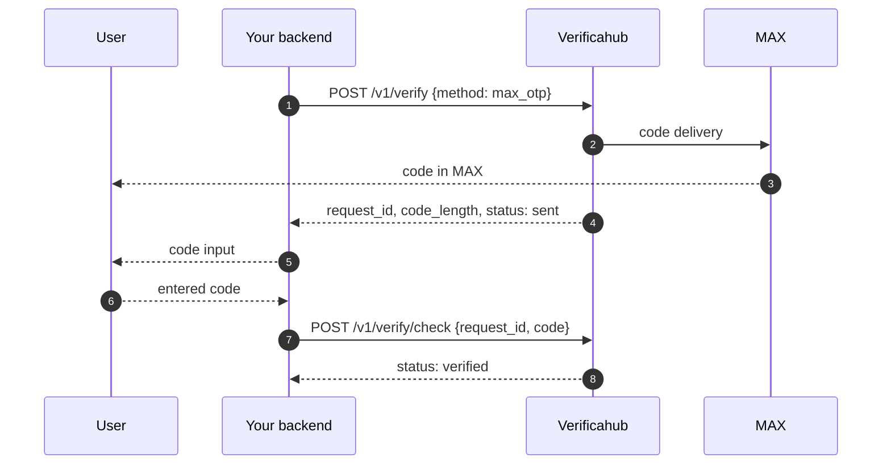
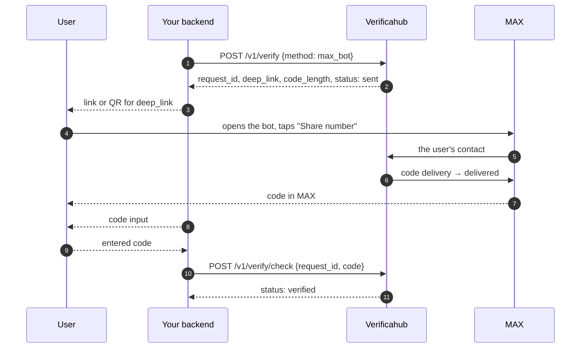
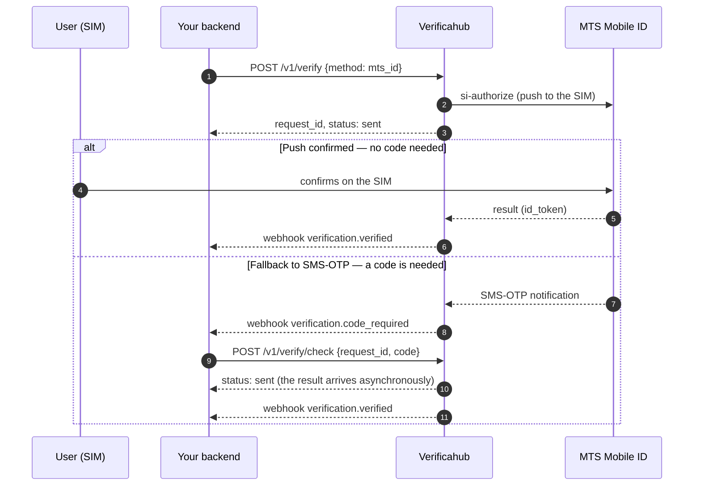

# How the verification flows work

The overall shape is the same for every method: `POST /v1/verify` creates a session, and you learn the
result either via a [webhook](../webhooks.md) or by polling `GET /v1/verify/{request_id}`. Only the
middle differs — how the user completes verification.

Session statuses: `sent` → `delivered` (optional) → `verified`, or `expired` (TTL ran out) /
`failed` (terminal error).

## Which method to pick

The question that decides everything else is whether you need a code input.

| No code typed | Code typed |
| --- | --- |
| [`reverse_flash_call`](./reverse_flash_call.md) — the user calls | [`sms`](./sms.md) · [`flash_call`](./flash_call.md) · [`pass_call`](./pass_call.md) |
| [`mts_id`](./mts_id.md) — confirmed on the SIM, but with a fallback to a code | [`telegram_otp`](./telegram_otp.md) · [`max_otp`](./max_otp.md) · [`max_bot`](./max_bot.md) |

Which methods your account may use and what they cost — see
[Verification methods and pricing](../../guides/methods.md).

## [`reverse_flash_call`](./reverse_flash_call.md) — no code typed

The user calls a number we hand out, and we verify by caller id. Nobody types a code.

→ [More on `reverse_flash_call`](./reverse_flash_call.md)

## [`sms`](./sms.md) — a code by SMS

The code arrives by SMS; the user enters it on your side and you submit it for checking. The same
"code → `/v1/verify/check` → `verified`" shape applies to every code-entry method below.

→ [More on `sms`](./sms.md)

## [`flash_call`](./flash_call.md) — the code is in the incoming number

We place a dropped call, and the code is the trailing `code_length` digits of the incoming number.

→ [More on `flash_call`](./flash_call.md)

## [`pass_call`](./pass_call.md) — a robot dictates the code

A robot calls and reads the code out. Unlike `flash_call`, this call has to be answered.

→ [More on `pass_call`](./pass_call.md)

## [`telegram_otp`](./telegram_otp.md) — a code from Telegram

The official Telegram bot delivers the code.

→ [More on `telegram_otp`](./telegram_otp.md)

## [`max_otp`](./max_otp.md) — a code in the MAX messenger

The message simply arrives — no links, no action from the user.

→ [More on `max_otp`](./max_otp.md)

## [`max_bot`](./max_bot.md) — a code through a MAX bot

The user opens the bot via `deep_link` and taps "Share number" — the code arrives only after that.
Billing is charge-on-delivery.

→ [More on `max_bot`](./max_bot.md)

## [`mts_id`](./mts_id.md) — operator-asserted

Two paths, and you don't know in advance which fires: usually the operator confirms right on the SIM,
but on failure it falls back to SMS-OTP. **Don't show a code input up front** — wait for the
`verification.code_required` webhook or the `awaiting_code: true` flag.

→ [More on `mts_id`](./mts_id.md)

## Learn the result: webhook or polling

Both work, and you can combine them (webhook as primary, polling as a safety net):

- **Webhook** — we push an event to your URL (see [Webhooks](../webhooks.md)).
- **Polling** — periodically request `GET /v1/verify/{request_id}` until a terminal status.

The source of truth on any mismatch is `GET /v1/verify/{request_id}`.
