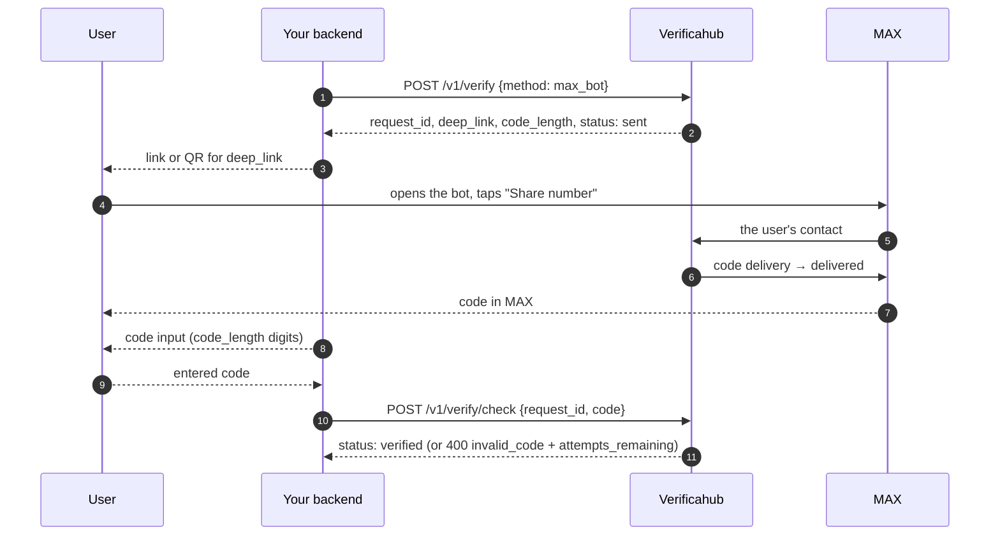

# `max_bot` — a code through a MAX bot

The difference from [`max_otp`](./max_otp.md) is that the user has to start the conversation. The
response to `POST /v1/verify` carries a `deep_link` (`https://max.ru/<bot>?start=<token>`); show it as
a link or a QR code. The user opens the bot, taps **"Share number"** — and only then does the code
arrive in MAX.

## What to watch for

- **The number must match.** The user has to share the **same** number the verification was started
  for, otherwise no code is sent.
- **Statuses tell the steps apart.** Before "Share number" the status is `sent`; after delivery it is
  `delivered` with `awaiting_code: true`.
- **Billing is charge-on-delivery.** If the user never opens the bot or never shares their number, no
  charge is applied.
- **The extra step costs conversion.** If you don't specifically need the bot dialogue, use
  [`max_otp`](./max_otp.md).
