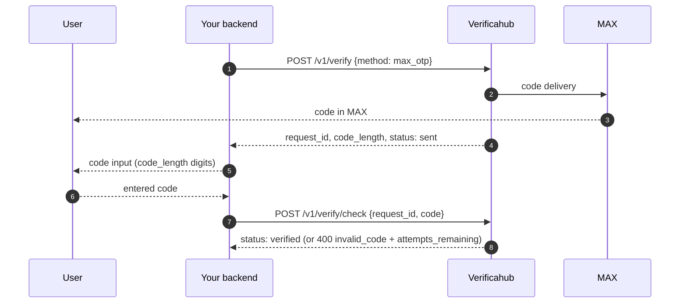

# `max_otp` — a code in the MAX messenger

The code arrives as a message in MAX. No links, no extra steps: it is already delivered by the time
you get the response to `POST /v1/verify`.

## What to watch for

- **Not to be confused with [`max_bot`](./max_bot.md).** There the user has to open the bot and share
  their number; here they do nothing — the message simply arrives. Most integrations want `max_otp`.
- **Show the code input straight away** after the `POST /v1/verify` response: the code is already sent.
- **The user needs MAX on that number** — otherwise there is nowhere to deliver it.
