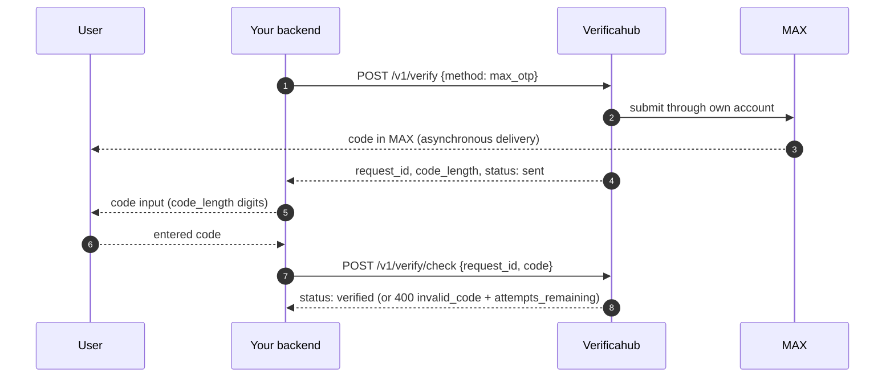

# `max_otp` — a code in the MAX messenger

The code is submitted as a MAX message without a bot link or contact-sharing
step. First [connect your MAX accounts](../../guides/max_accounts.md) in the
dashboard. A successful `POST /v1/verify` confirms accepted submission,
not handset receipt or reading.

## What to watch for

- **Not to be confused with [`max_bot`](./max_bot.md).** There the user has to open the bot and share
  their number; here they do nothing — the message simply arrives. Most integrations want `max_otp`.
- **Show the code input straight away** after the `POST /v1/verify` response: the code is already sent.
- **The user needs MAX on that number** — otherwise there is nowhere to deliver it.

## Private senders and errors

Once enrolled, only your accounts are used. Sending is unavailable without a
usable sender; there is no shared fallback. An unregistered destination returns
`422 delivery_unavailable` without a charge. Do not automatically retry an
unknown submission as a new verification.
