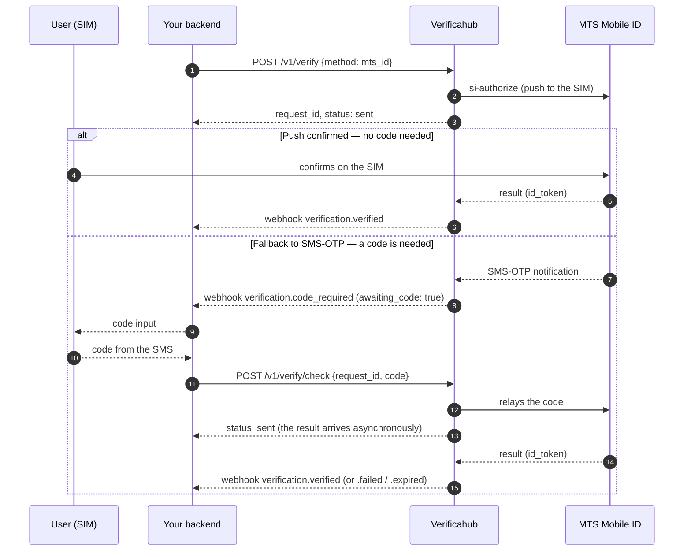

# `mts_id` — operator-asserted (dual path)

The key trait: `mts_id` has **two paths**, and you don't know in advance which fires. Usually the
operator confirms right on the SIM — and no code is needed. But if the push can't complete (e.g. an
MVNO number), it **falls back to SMS-OTP**, and only then does the user get a code to enter.

So **don't show a code input up front**. Wait for the signal: the `verification.code_required` webhook
or the `awaiting_code: true` flag in the status. No signal → no code.

## What to watch for

- **Poll `awaiting_code`** (or listen for `verification.code_required`) — show the code input only on
  that signal. Before it, `awaiting_code: false`.
- **`/v1/verify/check` is asynchronous.** We relay the code to the operator, and the final result
  arrives a moment later — so the `check` response is `status: sent`, not `verified`. Learn the
  outcome from `GET /v1/verify/{request_id}` or the `verification.verified` /
  `verification.failed` / `verification.expired` webhooks (an operator-consent timeout arrives as
  `expired`).
- **A code submitted too early** (before the fallback) returns `409 not_pending`.
