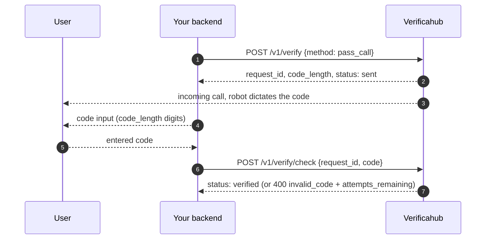

# `pass_call` — a robot dictates the code

A robot calls the user's number and reads out the code; the user enters it on your side.

## What to watch for

- **The call has to be answered** — unlike [`flash_call`](./flash_call.md), where it drops by itself.
  Say so in your interface.
- **Billing is on initiation**, not on the conversation: the call is placed when you ask for it,
  whether or not the user picks up.
- **Useful as a fallback** where SMS does not arrive and the user has no messengers.
