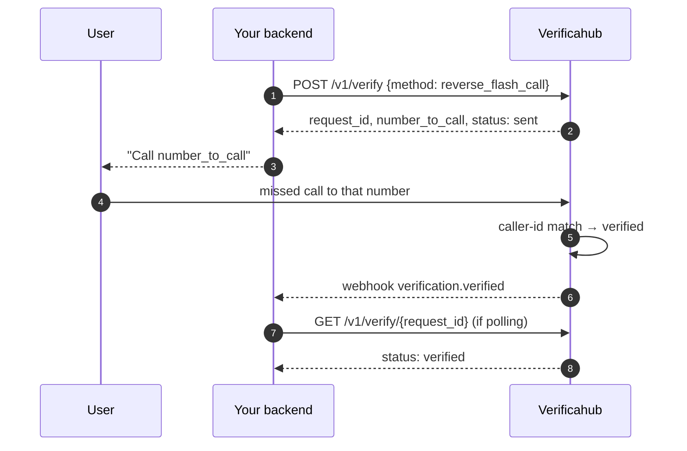

# `reverse_flash_call` — no code typed

The user calls a number we hand out, and we verify by caller id. Nobody types a code.

Show the user `number_to_call` and wait for `verified` (by webhook or polling).

## What to watch for

- **`/v1/verify/check` isn't used for this method.** There is nothing to type.
- **The number is handed out per session.** Read it from the response every time; the next session may
  get a different one.
- **A withheld caller id never matches.** If the user calls with caller id hidden there is nothing to
  compare, and the session runs to `expired`.
