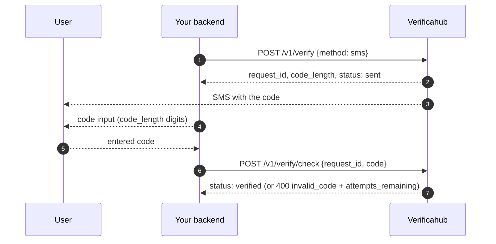

# `sms` — a code by SMS

We generate a code and deliver it to the user by SMS; the user enters it on your side and you submit
it for checking.

## What to watch for

- **Code length comes in `code_length`.** Don't hard-code it into your markup; it is a platform setting.
- **On a wrong code** the `400 invalid_code` response carries `attempts_remaining`; once attempts run
  out the session moves to `failed`.
