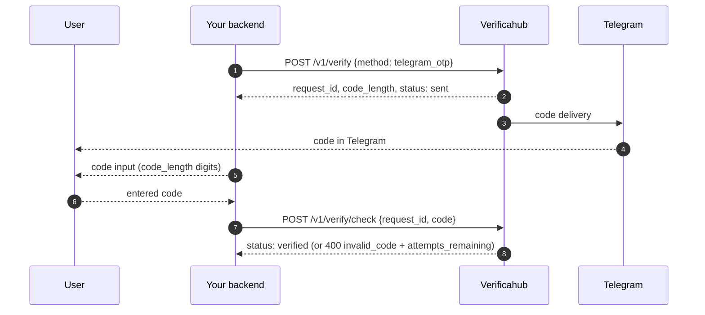

# `telegram_otp` — a code from Telegram

We generate a code and deliver it to Telegram through the official bot; the user enters it on your
side and you submit it for checking.

## What to watch for

- **The user needs Telegram on that number.** With no account there is nowhere to deliver the code —
  have a fallback method ready.
- **On a wrong code** the `400 invalid_code` response carries `attempts_remaining`; once attempts run
  out the session moves to `failed`.
